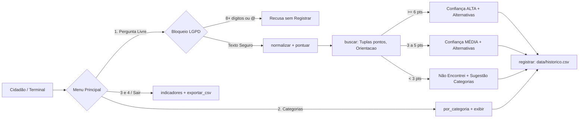

#  Citizen Assist AI — Assistente Digital de Orientação à Pessoa Idosa

| Item | Detalhes |
|---|---|
| **Disciplina** | Pensamento Computacional e Automação com Python — FIAP (GS 2026.2) |
| **Turma** | `1CCPJ` (Modalidade: Dupla) |
| **Integrantes** | Gustavo de Souza Correa (`RM570746`) e Arthur Tae Gun Yong (`RM570647`) |
| **Público e Tema** | Pessoas Idosas (60+ anos), familiares e cuidadores — Direitos, Saúde, Transporte e Benefícios (INSS/BPC) |
| **ODS Relacionados** | **ODS 3** (Saúde e Bem-Estar), **ODS 10** (Redução das Desigualdades) e **ODS 16** (Paz, Justiça e Instituições Eficazes) |
| **Vídeo Técnico** | *[Inserir Link do Vídeo Não Listado no YouTube]* (ver também `entrega_fiap.txt`) |

## Problema Escolhido e Solução

Pessoas idosas e seus familiares perdem muito tempo tentando descobrir quais documentos levar e onde ir para emitir o Cartão SUS, retirar medicamentos gratuitos na Farmácia Popular, fazer a Prova de Vida do INSS ou solicitar o BPC/LOAS. Na internet, essas informações estão espalhadas em linguagem técnica ou misturadas com páginas falsas que aplicam golpes financeiros. O **Citizen Assist AI** resolve isso no terminal Python com respostas em linguagem simples, base verificada em portais oficiais, aviso de transparência e bloqueio automático de dados pessoais.

## Fluxo do Sistema e Arquitetura POO



**Composição de Classes (`main.py` → `Assistente` → `BaseConhecimento` → `Orientacao`):**
- `Orientacao` (`orientacao.py`): Guarda os 9 atributos do registro CSV e exibe na tela (`exibir()`) com fonte e aviso oficial.
- `BaseConhecimento` (`base_conhecimento.py`): Lê o CSV com `open()`, `for` e `split(";")`, organiza em dicionários e instancia a lista `self.orientacoes` (`split("|")` para listas internas).
- `Assistente` (`assistente.py`): Recebe `BaseConhecimento` por composição, executa `perguntar()`, `navegar()`, `registrar()`, `indicadores()` e `exportar_csv()`.

## Base de Conhecimento e Fontes Oficiais (`data/base_conhecimento.csv`)

Todas as **13 orientações** (divididas em **3 categorias**, com **5 palavras-chave** cada) foram verificadas em portais oficiais (IDs 1 a 12 em **17/11/2026**; ID 13 incluído após o teste com usuários, em **19/11/2026**):

| ID | Categoria | Título da Orientação | Palavras-Chave (`\|`) | Fonte Oficial Verificada |
|---|---|---|---|---|
| `1` | Saúde | Fazer o Cartão Nacional de Saúde (Cartão SUS) | `cartao do sus\|sus\|cns\|fazer cartao\|meu sus digital` | [meususdigital.saude.gov.br](https://meususdigital.saude.gov.br/) |
| `2` | Saúde | Retirar medicamentos gratuitos na Farmácia Popular | `farmacia popular\|remedio gratuito\|remedios\|medicamento\|fralda geriatrica` | [gov.br/saude (Farmácia Popular)](https://www.gov.br/saude/pt-br/composicao/sectics/farmacia-popular) |
| `3` | Saúde | Vacinação gratuita para idosos (Gripe, Covid, Pneumonia e outras) | `vacina\|vacinacao\|posto de saude\|gripe\|calendario de vacinacao` | [gov.br/saude (Vacinação)](https://www.gov.br/saude/pt-br/vacinacao) |
| `4` | Saúde | Atendimento prioritário e acompanhante em hospitais | `acompanhante\|internacao\|prioridade hospital\|atendimento prioritario\|direito saude` | [Planalto (Estatuto do Idoso — Lei 10.741)](https://www.planalto.gov.br/ccivil_03/leis/2003/l10.741.htm) |
| `5` | Transporte e Direitos | Emitir a Carteira da Pessoa Idosa para viagens interestaduais | `carteira do idoso\|carteira da pessoa idosa\|viagem de onibus\|passagem gratuita\|transporte interestadual` | [carteiraidoso.cidadania.gov.br](https://carteiraidoso.cidadania.gov.br/) |
| `6` | Transporte e Direitos | Solicitar credencial de estacionamento em vaga de idoso | `vaga de idoso\|estacionamento\|cartao de estacionamento\|credencial idoso\|detran` | [Portal de Serviços Senatran](https://portalservicos.senatran.serpro.gov.br/) |
| `7` | Transporte e Direitos | Gratuidade no transporte público urbano (ônibus, metrô e trem) | `onibus gratuito\|transporte gratuito\|bilhete unico idoso\|passagem de onibus\|metro gratuito` | [SPTrans Oficial](https://www.sptrans.com.br/) |
| `8` | Transporte e Direitos | Denunciar golpes financeiros, violência ou maus-tratos | `denuncia\|golpe\|violencia contra idoso\|disque 100\|procon` | [Consumidor.gov.br](https://www.consumidor.gov.br/) |
| `9` | Benefícios e INSS | Solicitar o BPC/LOAS (Benefício de Prestação Continuada) | `bpc\|loas\|beneficio assistencial\|um salario minimo\|sem contribuicao` | [Portal Meu INSS](https://meu.inss.gov.br/) |
| `10` | Benefícios e INSS | Como funciona a Prova de Vida do INSS atualmente | `prova de vida\|inss\|recadastramento\|bloqueio de beneficio\|meu inss` | [Portal Oficial INSS (gov.br/inss)](https://www.gov.br/inss/pt-br) |
| `11` | Benefícios e INSS | Pedir Aposentadoria por Idade no INSS | `aposentadoria\|aposentar por idade\|tempo de contribuicao\|pedir aposentadoria\|inss aposentadoria` | [Portal Meu INSS](https://meu.inss.gov.br/) |
| `12` | Benefícios e INSS | Solicitar Isenção de IPTU para Aposentados e Pensionistas | `isencao de iptu\|iptu idoso\|desconto iptu\|nao pagar iptu\|aposentado iptu` | [Portal SP156 (Prefeitura de SP)](https://sp156.prefeitura.sp.gov.br/) |
| `13` | Benefícios e INSS | Tarifa Social de Energia Elétrica (desconto na conta de luz) | `tarifa social\|conta de luz\|desconto na luz\|energia eletrica\|luz gratuita` | [ANEEL (gov.br/aneel)](https://www.gov.br/aneel/pt-br) |

## Regras de Pontuação, Decisões Técnicas e Teste com Usuários

- **Busca Inteligente por Regras (`pontuar` e `buscar`):**
  - **+3 pontos** para cada palavra-chave da orientação presente na pergunta normalizada.
  - **+1 ponto** para cada palavra única da pergunta (4+ letras) presente no título da orientação. Palavras comuns de pergunta (`como`, `onde`, `para`, `quais`, `preciso`...) ficam na lista `PALAVRAS_IGNORADAS` e não pontuam, pois antes a palavra *"como"* fazia aparecer alternativas sem relação (ex.: *"Como funciona a Prova de Vida"* sugerida para uma dúvida sobre o Cartão SUS).
  - **Confiança ALTA:** `>= 6 pontos` | **Confiança MÉDIA:** `3 a 5 pontos` | **Não encontrei:** `< 3 pontos` (sugere outras palavras e categorias).
  - **Tentativas e tempo:** quando a dúvida não é encontrada e o usuário reformula a pergunta, o contador de tentativas e o cronômetro **não são zerados**. Assim, o registro mostra quantas tentativas e quanto tempo foram necessários até encontrar a orientação.
- **Decisão Técnica (recarregar a base):** o `main.py` chama `base.carregar()` sempre que o usuário entra nas opções 1 ou 2. Com isso, uma palavra-chave nova adicionada ao CSV passa a valer **sem reiniciar o programa**, o que permite a alteração ao vivo pedida no vídeo.
- **Decisão Técnica (`normalizar`):** além dos sinais pedidos no enunciado, também removemos `/` e `-` (ex.: *"BPC/LOAS"* vira *"bpc loas"*). Os espaços delimitadores (`" " + texto + " "`) evitam falsos positivos de siglas curtas dentro de outras palavras (ex.: evita que `sus` pontue na palavra *"assustado"*).
- **Proteção de Dados e Resiliência:** Perguntas com **8 ou mais dígitos** (CPF/telefone) ou **`@`** (e-mail) são bloqueadas antes da busca e nunca são salvas no CSV. Opções fora da faixa ou arquivos ausentes não interrompem a execução.
- **Integração com outras disciplinas:** Escopo focado **100% em Python puro** (POO, composição e manipulação nativa de arquivos com `open()`/`write()`).
- **Limitações:** Por utilizar correspondência léxica por regras (sem LLM/embeddings), sinônimos não mapeados no CSV exigem reformulação da pergunta ou uso do menu de categorias; além disso, regras municipais específicas (como IPTU) variam conforme a prefeitura.
- **Resultados do Teste com Usuários (3 pessoas externas — 10 atendimentos em 17/11/2026):**
  - `Resposta encontrada (%)`: **90,0%** (9 de 10 atendimentos)
  - `Taxa de acerto: ajudou (%)`: **80,0%** (8 de 10 atendimentos)
  - `Tempo médio para encontrar`: **11,9s**
  - `Tentativas por atendimento`: **1,1**
  - `Facilidade de uso (1 a 5)`: **4,7 / 5,0**
  - `Dúvidas sem solução`: *"Como conseguir desconto na conta de luz para idoso?"* (não encontrada) e *"Solicitar Isencao de IPTU para Aposentados e Pensionistas"* (usuário buscava prazo específico da prefeitura local).
  - `Melhorias aplicadas após teste`:
    1. Inclusão da palavra-chave `fralda geriatrica` na orientação `ID 2` (Farmácia Popular) após dúvida real durante os testes.
    2. Criação da orientação `ID 13` (Tarifa Social de Energia Elétrica) para responder a dúvida *"desconto na conta de luz para idoso"*, que não tinha sido encontrada no teste. Agora a pergunta é respondida com confiança MÉDIA (palavra-chave `conta de luz`).

## Como Executar no Terminal

1. Abra o terminal na pasta raiz do projeto (`citizen-assist-ai/`).
2. Execute o programa com Python 3 (sem necessidade de bibliotecas externas):
   ```bash
   python main.py
   ```
3. Utilize as opções `1` (Pergunta livre), `2` (Navegar por categorias), `3` (Indicadores), `4` (Exportar `data/atendimentos.csv`) ou `0` (Avaliar facilidade e sair).
